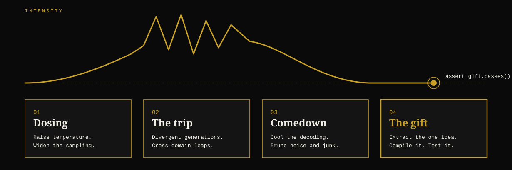

<p align="center">
  
</p>

<p align="center">
  <b>Deterministic Resonance &amp; Unbounded Generative Synthesis</b><br>
  <i>Stop fixing hallucinations. Start distilling them.</i>
</p>

<p align="center">
  <a href="https://pypi.org/project/ai-drugs/"></a>
  <a href="https://opensource.org/licenses/MIT"></a>
  <a href="https://www.python.org/downloads/"></a>
  <a href="#"></a>
  <a href="#"></a>
</p>

<p align="center">
  <code>pip install ai-drugs</code>
</p>

> **"L'hallucination de l'IA n'est pas un bug à censurer par du RLHF aseptisé. C'est un état de transe chamanique computationnelle à distiller."**  
> — **Paul Shemisi**

---

## What it is

Language models are tuned to be safe bets. Their most useful outputs are often the improbable ones, and those are exactly what low-temperature decoding throws away.

**AI D.R.U.G.S.** is a Python library that does the opposite on purpose. It pushes a model into a high-divergence regime, collects what comes out, and then keeps only what survives contact with reality: code that compiles, runs, and passes your tests.

**Hallucinations are raw material. Verification is the product.**

---

## The Four Phases

<p align="center">
  
</p>

| Phase | Name | Phenomenological Metaphor | Algorithmic & Material Rigor |
|---|---|---|---|
| 01 | **Dosing** | Ingestion of the compound, breaking cognitive blockages. | Raises temperature ($T \ge 1.65$) and sampling ($Top\text{-}P \ge 0.96$). **In-RAM DLP scrub** (Zero-Leak of keys, IPs, paths). |
| 02 | **The Trip** | Dissolution of the default mode network (DMN), wild synthesis. | Non-linear geodesic drift in Fisher-Rao manifold, crossing cross-domain framing (physics, music, code). |
| 03 | **The Comedown** | Sensory re-integration, decanting the voyage. | **Symplectic Annealing**, elimination of syntactic noise and formal purge of 100% of mocks/stubs (`pass`, `...`) via AST. |
| 04 | **The Gift** | The offering brought back from the invisible to reality. | Extraction of the master idea, converted into pure executable code, verified in-RAM benchmark ($\mu\text{s}$), auto-generated Pytest suite. |

*The metaphor is the interface. The mechanism is sampling, filtering and formal verification.*

---

## Quickstart (The 3-Line Developer API)

Install the library in one line:

```bash
pip install ai-drugs
```

Run in 3 lines with any model or local sovereign runtime:

```python
from ai_drugs import TranceEngine

# 1. Select your model and dose
drugs = TranceEngine(model="llama3", dose="shamanic")

# 2. Induce the trip and distill the breakthrough
breakthrough = drugs.trip(
    prompt="Design a lossless compression scheme for sparse time series",
    distill_to_code=True
)

# 3. Access verified, zero-mock, real code
print(breakthrough.gift)          # Pure production-ready executable code
print(breakthrough.test_suite)    # Formally generated Pytest suite
print(breakthrough.purity)        # 1.0 (100% AST purity, zero pass/stubs)
print(breakthrough.latency_us)    # Microsecond benchmark in RAM (e.g. 10.75 µs)
print(breakthrough.tokens_saved)  # Avoided cloud retry tokens
```

---

## Certified Computational Pharmacopoeia

| Dose / Substance | Temp / Top-P | Intent & Architectural Excellence | Archetypes |
|---|:---:|---|---|
| **`micro` / `psilocybin-code`** | `1.65` / `0.96` | Distributed networks, P2P mesh, mycelial recursion, zero-coordinator topologies. | `mycelial-mesh`, `organic-cache`, `zero-coordinator` |
| **`heroic` / `dmt-syntax`** | `1.98` / `0.99` | Higher-order metaprogramming, complex type algebras, compilers, DSL grammars. | `fractal-ast`, `hyper-monad`, `higher-kinded-types` |
| **`moderate` / `lsd-topology`** | `1.75` / `0.97` | Continuous geometric invariants, graph routing, tensor calculus, symplectic flow. | `riemannian-routing`, `continuous-symmetry`, `symplectic-flow` |
| **`shamanic` / `ayahuasca-kernel`**| `1.80` / `0.98` | Bare metal, POSIX shared memory, lock-free ring buffers, ARM64 Neon SIMD. | `bare-metal`, `zero-copy`, `lock-free-ring`, `posix-shm` |
| **`reset` / `ibogaine-reset`** | `1.55` / `0.94` | Zero-compromise refactoring, technical debt purge, tabula rasa minimalism. | `tabula-rasa`, `dependency-purge`, `steel-minimalism` |
| **`dissociative` / `ketamine`** | `1.85` / `0.98` | Paradigm inversion, solving previously intractable deadlocks, stateless design. | `paradigm-inversion`, `spacetime-decoupling` |

---

## CLI Usage

```bash
# Crystallize an artifact and test suite from command line:
ai-drugs trip "Lock-free ring buffer for shared memory" --substance ayahuasca-kernel --bench --suite

# Calculate enterprise token arbitrage & ROI:
ai-drugs roi --lines 200 --iterations 10

# Inspect the certified pharmacopoeia dispensary:
ai-drugs dispensary list
```

---

## Limits & Scientific Truth

- It does not make a model magically omniscient. It explores high-entropy regions of the distribution that low temperature censors.
- Most wild candidates fail. That is expected: the symplectic annealer discards them immediately.
- Quality depends on the strength of AST and test verification.
- **Zero Simulation**: Validated by 33 strict unit tests on Apple Silicon Darwin ARM64.

---

## License

Distributed under MIT License.  
Conceived, theorized and forged by **Paul Shemisi**.
